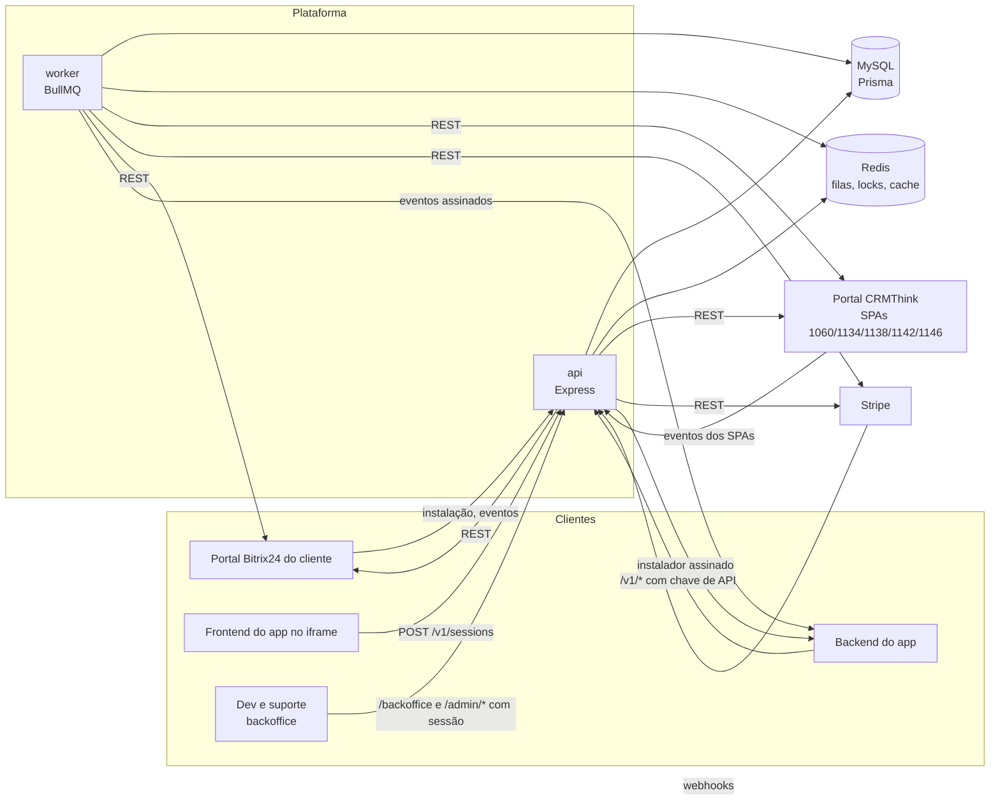

# Arquitetura

Código: `src/api.ts`, `src/worker.ts`, `src/bootstrap.ts`, `src/container.ts`, `src/app.ts`,
`src/backoffice-web.ts`, `src/modules/*`, `src/shared/*`, `web/backoffice/`.

## Visão geral

A plataforma centraliza, para todas as aplicações CRMThink (GPTMaker, ThinkZap, ...), o que
antes cada uma fazia sozinha: instalação no Bitrix24, guarda e renovação de tokens, login do
iframe e cobrança. Os apps falam com ela por HTTP (chave de API) e recebem eventos assinados.



## Processos

Os dois processos usam o mesmo `bootstrap()` e o mesmo `container`; mudam só o que expõem.

| Processo | Entrada | O que faz |
| --- | --- | --- |
| `api` | `src/api.ts` → `createApp` (`src/app.ts`) | Todas as rotas HTTP. Grava eventos no outbox e enfileira webhooks; não entrega eventos. Revalida a configuração dos SPAs a cada 10 min (resultado em `/health/ready`). |
| `worker` | `src/worker.ts` | Consome as filas `stripe-events` e `spa-events` e os agendamentos (entrega de eventos, renovação de tokens, trials, avisos, varreduras). Expõe `/metrics` e `/health` na mesma `PORT`. |

### Backoffice (`web/backoffice`)

App React (Vite, Tailwind, shadcn/ui, React Router, TanStack Query) para dev e suporte. Tem
`package.json` e `yarn.lock` próprios: as dependências dele não entram no runtime da API. A
imagem Docker compila o app num estágio separado (`node:22-alpine`) e leva só o `dist`, que a
própria `api` serve em `/backoffice` (`src/backoffice-web.ts`):

- **mesma origem de `/admin/*`**: o cookie de sessão (`Path=/admin`, `SameSite=Strict`) vai sem
  CORS e o navegador manda `Origin` nas mutações, como o `adminGate` exige
  (`BACKOFFICE_ORIGINS` = host da API em cada ambiente);
- `assets/*` com hash no nome: `Cache-Control: public, max-age=31536000, immutable`; qualquer
  outro caminho devolve `index.html` com `no-store` (o roteamento é do navegador);
- headers só nesta rota: `Content-Security-Policy` (`default-src 'self'`, `script-src 'self'`,
  `style-src 'self' 'unsafe-inline'` pelos componentes que aplicam estilo inline,
  `connect-src 'self'`, `frame-ancestors 'none'`, `base-uri 'none'`), `X-Content-Type-Options`,
  `Referrer-Policy: same-origin` e `X-Frame-Options: DENY`. Nada é carregado de outra origem
  (a fonte é empacotada);
- montado como middleware, não como rota: fica fora do contrato OpenAPI. Sem `dist` (API em dev
  sem o build do web), `/backoffice` responde 404 com o comando de build.

O cliente HTTP do app usa tipos gerados de `docs/api/openapi-admin.json` (`yarn gen:api`); o
job `web` do CI falha se eles divergirem do contrato (`yarn check:api`).

Ambos encerram com `SIGTERM`/`SIGINT` de forma graciosa (15 s na `api`, 30 s no `worker`).
Podem rodar várias instâncias: locks no Redis e *job schedulers* do BullMQ garantem que cada
disparo rode uma vez (ver [async-processing.md](async-processing.md)).

## Boot

`bootstrap(service)` (`src/bootstrap.ts`):

1. Valida o ambiente (`src/config/env.ts`); configuração inválida derruba o processo com a lista
   de problemas — sem chave de cifragem nada sobe.
2. Configura o logger (pino, opcionalmente Loki).
3. Recusa `BITRIX_TLS_REJECT_UNAUTHORIZED=false` em produção.
4. Cria Prisma, Redis e a fila; monta o `container`.
5. Garante uma chave de assinatura do JWT ativa (semeia de `JWT_SIGNING_PRIVATE_KEY` se o banco
   não tem nenhuma).

## Módulos

```
src/
  app.ts, api.ts, worker.ts, bootstrap.ts, container.ts, health.ts
  config/           env.ts (variáveis), spa-config.ts (IDs e campos dos SPAs)
  docs/             catálogo de erros e geração do OpenAPI
  modules/
    registry/       cadastro de apps, chaves de API, autenticação de app e operador
    installations/  instalação, eventos do Bitrix, cofre de tokens, sessão/JWT
    billing/        planos, assinaturas, Stripe, SPAs, trial, itens, compras, varreduras
    events/         outbox e entrega de eventos aos apps
  shared/           bitrix (clientes REST/OAuth), crypto, http (erros), infra
                    (prisma, redis, fila, cache), observability (log, métricas, alertas)
```

Cada módulo segue `domain/` (tipos), `application/` (serviços), `infra/` (adaptadores),
`http/` (rotas) e, quando há troca de implementação, `ports/`:

- `billing/ports/payment-gateway.ts` — o Stripe (`infra/stripe`) atrás de uma porta; os testes
  usam `FakeGateway`.
- `installations/ports.ts` — o que `billing` precisa de `installations` (`InstallationView`,
  `TrialStarter`), sem importar os serviços dela.

A fronteira `installations` ↔ `billing` passa só por essas portas; as duas se encontram no
`container`.

## Container

`buildContainer(deps)` (`src/container.ts`) instancia todos os serviços uma vez e injeta
dependências por construtor. Nada lê `env()` fora dele e do `bootstrap`. Os testes montam o
mesmo container com dublês (`src/test/harness.ts`: `FakePrisma`, `FakeCrm`, `FakeGateway`,
`FakeBitrixPortal`, relógio controlado) — por isso os testes de integração passam pelo
Express real com toda a lógica de domínio.

## Onde ficam os dados

- **MySQL** (Prisma): estado técnico da plataforma — apps, instalações, credenciais cifradas,
  chaves de assinatura, outbox, eventos Stripe recebidos, versões. Ver [data-model.md](data-model.md).
- **SPAs do portal CRMThink** (Bitrix24): fonte de verdade comercial — produtos (1134), planos
  (1138), instalações (1060), assinaturas (1142) e itens (1146). O time comercial edita ali;
  a plataforma espelha e reage (ver [billing.md](billing.md)).
- **Redis**: filas BullMQ, locks distribuídos, cache dos SPAs, `application_token` pendente.
- **Stripe**: cobrança; conta de produção ou de teste conforme `STRIPE_SECRET_KEY`.
