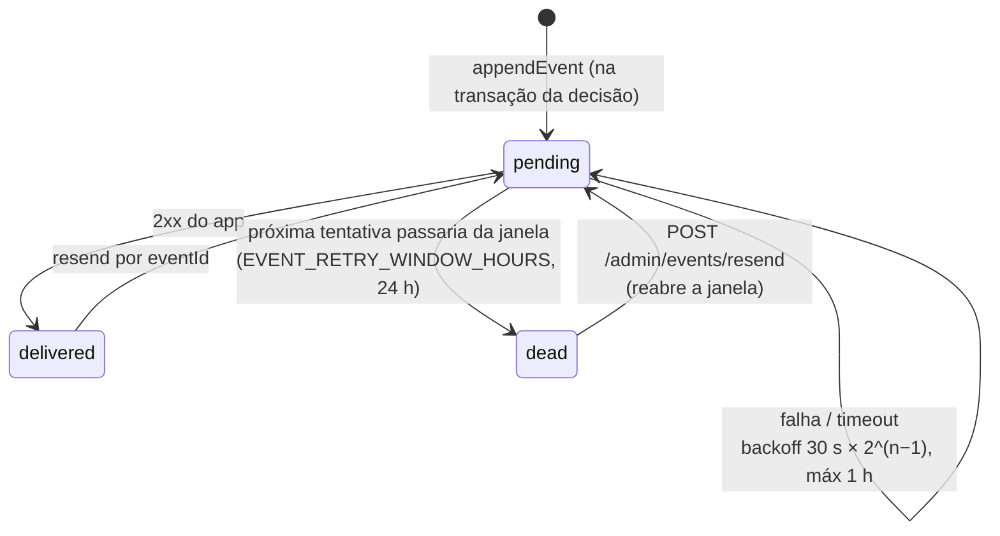

# Processamento assíncrono

Código: `src/worker.ts`, `src/shared/infra/queue.ts`, `src/shared/infra/redis.ts`,
`src/modules/events/outbox.ts`, `src/modules/events/event-delivery.ts`.

Tudo que não precisa responder na hora roda no processo `worker`, sobre BullMQ/Redis
(prefixo `QUEUE_PREFIX`). A `api` só grava no banco e enfileira.

## Filas

| Fila | Produtor | Consumidor | Concorrência | Retry |
| --- | --- | --- | --- | --- |
| `stripe-events` | `POST /webhooks/stripe` (após gravar `stripe_event`) | `StripeEventProcessor.process(eventId)` | 5 | 8 tentativas, backoff exponencial a partir de 30 s; esgotadas ⇒ `stripe_event.status = dead` + métrica |
| `spa-events` | `POST /bitrix/spa-events` | `SpaEventProcessor.process` (produto/plano: invalida cache; 1060 removido: desvincula instalação; 1142: regras da assinatura manual; 1146: mudança humana de item) | 5 | mesma política; evento perdido é recuperado pela varredura `spa` |
| `scheduled` | *job schedulers* abaixo | handlers do worker | 4 | 1 tentativa (o próximo disparo repete) |

O processamento é idempotente: o evento Stripe é relido do banco pelo id, e decisões têm
`dedupeKey`.

## Agendamentos

Registrados com `upsertJobScheduler`: com várias instâncias do worker, cada disparo roda em
uma só. `WORKER_DISABLE_SCHEDULES=true` desliga todos (útil em desenvolvimento).

| Id | Frequência | O que faz |
| --- | --- | --- |
| `deliver-events` | 5 s | Um ciclo do relay do outbox (abaixo) |
| `refresh-tokens` | 60 s | Renova credenciais que vencem em menos de 10 min (até 200 por ciclo) |
| `expire-trials` | 15 min | Trials vencidos → `trial_expired` + `subscription.ended` |
| `period-ending` | diário 09:00 `America/Sao_Paulo` | Avisos `subscription.period_ending` das manuais (3, 2, 1 dia) |
| `sweep-stripe` | 1 h | Reconciliação Stripe → SPA 1142 |
| `sweep-spa` | 15 min | Reconciliação dos SPAs 1142/1146 alterados |
| `gauges` | 60 s | Atualiza as métricas de instalações pendentes/`AUTH_ERROR` e eventos pendentes/mortos |

Varredura que falha incrementa `platform_sweep_failures_total` e gera alerta `sweep.failed`.

## Locks

`withLock(store, chave, { ttlMs, waitMs? })` (`src/shared/infra/redis.ts`): lock no Redis com dono
(UUID) e TTL, liberado só por quem o tomou; `waitMs` espera o lock por polling. Chaves usadas:

| Chave | Onde | Por quê |
| --- | --- | --- |
| `token-refresh:{installationId}` | Cofre de tokens | Uma renovação por instalação por vez (refresh token rotativo) |
| `delivery:{appCode}:{installationId}` | Entrega de eventos | Um entregador por instalação (ordem) |
| lock por instalação da cobrança | `BillingContext.withInstallationLock` | Decisões de assinatura/itens serializadas (`BILLING_BUSY`) |

## Outbox e entrega de eventos

1. **Gravação**: `appendEvent(tx, ...)` grava o envelope em `outbox_event` **dentro da transação
   da decisão**. Se o processo cair depois do commit, o evento continua `pending` e sai no
   próximo ciclo; nada se perde entre o commit e um enfileiramento. Não grava se a `dedupeKey`
   já existe ou se o app está inativo.
2. **Relay** (`deliver-events`, a cada 5 s): lê até 100 pendentes vencidos em ordem de `seq` e
   pega **só o mais antigo de cada instalação**; se houver um mais antigo ainda em backoff, a
   instalação espera. Assim `installation.created` nunca chega depois de
   `subscription.trial_started`.
3. **Entrega**: `POST <webhookUrl>` com `X-Platform-Signature`, `X-Platform-Event-Id`,
   `X-Platform-Event-Type`, timeout `WEBHOOK_TIMEOUT_MS` (10 s). Cada tentativa vai para
   `event_delivery`.
4. **Falha** (não 2xx, timeout, app inativo, sem `webhookUrl`): próxima tentativa em
   `30 s × 2^(tentativa−1)`, limitado a 1 h. Se passaria do fim da janela (24 h desde a criação
   ou do último reenvio), vira `dead` + alerta `event.dead_letter` + `platform_events_dead`.

Garantias para o app: **pelo menos uma vez** (deduplicar por `eventId`) e **em ordem por
instalação** (reenvios manuais podem chegar depois; usar `subscription.version`).

### Investigar evento não entregue

1. `GET /admin/events?appCode=<app>&status=pending|dead` — status, tentativas e as 3 últimas
   entregas (status HTTP e erro de cada uma).
2. Erro `HTTP 5xx`/timeout: problema no app; `aplicação inativa`: app desativado no cadastro.
3. Corrigido o app, `POST /admin/events/resend` com `{ eventId }` ou
   `{ appCode, from, to, onlyDead?, type? }` — os eventos voltam a `pending` com janela nova.
4. Métricas: `platform_events_pending`, `platform_events_dead`,
   `platform_event_deliveries_total{outcome}`; alertas `EventsBacklog` e `EventsDeadLetter`.
