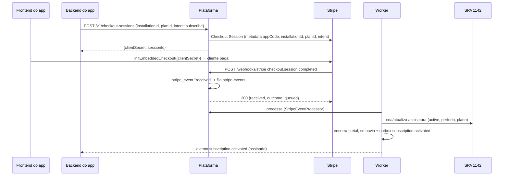

# Cobrança

Código: `src/modules/billing/` — `application/checkout-service.ts`, `stripe-webhooks.ts`,
`stripe-lifecycle.ts`, `manual-lifecycle.ts`, `subscription-writer.ts`,
`subscription-queries.ts`, `items-service.ts`, `purchase-service.ts`, `refund-service.ts`,
`trial-service.ts`, `period-ending-job.ts`, `sweeps.ts`, `spa-events.ts`, `plan-catalog.ts`;
`infra/stripe/`, `infra/spa/`; porta `ports/payment-gateway.ts`.

## Princípios

- **SPAs são a fonte de verdade comercial**; o Stripe é a fonte de verdade do pagamento. A
  plataforma espelha o Stripe no SPA 1142/1146 e reage a edições humanas nos SPAs.
- **Toda decisão gera no máximo um evento**: a escrita no banco e o evento no outbox vão na
  mesma transação, com `dedupeKey` da decisão (ex.: `renewed:<assinatura>:<início do período>`).
  Webhook repetido, reprocessamento ou varredura não duplicam evento.
- **Versão por assinatura** (`subscription_version.version`) sobe a cada decisão e vai no
  evento: o app ignora evento com versão menor que a última aplicada.
- **Anti-loop**: a plataforma grava um marcador de versão no item do SPA; o evento do SPA que
  volta com o próprio marcador é reconhecido como eco e ignorado. Sem o marcador, é edição
  humana.
- A plataforma **informa**; carência, corte de acesso, créditos e limites são decisão do app.

## Modalidades

| Modalidade | Quem cobra | Como muda |
| --- | --- | --- |
| `stripe` | Stripe (checkout embutido, renovação automática) | Webhooks do Stripe; troca de plano pela API; Customer Portal |
| `manual` | Comercial (boleto, contrato) | Pessoa edita a assinatura no SPA 1142; a plataforma reage ao evento do SPA |

## Assinatura via Stripe

Mapa de eventos Stripe → decisão:

| Stripe | Decisão | Evento para o app |
| --- | --- | --- |
| `checkout.session.completed` (assinatura) | Cria/ativa assinatura no SPA; encerra trial | `subscription.activated` |
| `checkout.session.completed` (pagamento) | Compra `paid` | `purchase.paid` |
| `checkout.session.expired` | Compra `expired` | — |
| `invoice.paid` | Novo período (ou recuperação de atraso) | `subscription.renewed` / `subscription.recovered` |
| `invoice.payment_failed` | `past_due` | `subscription.past_due` (com `hostedInvoiceUrl`) |
| `customer.subscription.updated` | Plano, período, cancelamento agendado, quantidade | `subscription.plan_changed`, `subscription.cancel_scheduled` |
| `customer.subscription.deleted` | Encerrada | `subscription.ended {reason: cancelled}` |
| `charge.refunded` | Reembolso da compra ou fatura | `charge.refunded` |
| `charge.dispute.created` | Disputa + alerta operacional | `charge.disputed` |

O webhook só grava e enfileira (resposta rápida ao Stripe). O processamento (fila
`stripe-events`, 8 tentativas com backoff exponencial de 30 s) marca `processed`/`ignored`;
esgotadas as tentativas, `dead` + métrica. `GET /admin/stripe-events` mostra status e erro.

### Troca de plano

`POST /v1/subscriptions/{id}/change-plan`:

- **Upgrade** (plano mais caro): troca imediata no Stripe com fatura proporcional
  (`always_invoice`); o SPA e o evento `plan_changed {effective: immediate, remainingFraction}`
  saem quando a fatura é paga.
- **Downgrade**: agendado para o fim do período (`effective: next_period`).
- Assinatura manual: 422 `MANUAL_SUBSCRIPTION`.

### Customer Portal

`POST /v1/billing-portal-sessions` devolve a URL do portal do Stripe (cartão, faturas,
cancelamento). Mudanças feitas lá chegam por webhook como qualquer outra.

## Trial

- Automático na instalação (`trialOnInstall`), solicitado pelo app com o contato do
  cliente (`POST /v1/installations/{id}/trial`, chave do app) ou manual pelo operador
  (`POST /admin/installations/{id}/trial`, contato opcional).
- Solicitação pelo app: grava o contato (`installation.contact` e campos do SPA 1060, com
  cargo em `installation.role`) antes das checagens, sob o lock da instalação. Sem trial,
  cria (`201`). Com trial vigente devolve esse trial (`200`). O operador recebe
  `TRIAL_ALREADY_USED` nesse caso. Falha ao gravar no SPA só vai ao log (`warn`); o banco
  é a fonte do contato, e o checkout usa o e-mail dele.
- Cria assinatura `trialing` no SPA 1142 com o plano de trial (`trialPlanId`) e fim em
  `agora + trialDays`; marca `trial_used` na instalação (um trial por instalação:
  `TRIAL_ALREADY_USED`). Evento `subscription.trial_started`.
- Job `expire-trials` (15 min): trial vencido vira `trial_expired`, evento
  `subscription.ended {reason: trial_expired}`.
- Ativação paga durante o trial encerra o trial (`subscription.activated {previousSubscriptionId}`).

## Assinatura manual

O comercial cria/edita a assinatura no SPA 1142 (`modality = manual`). O evento do SPA vai para
a fila `spa-events`; `ManualLifecycle` compara com o último estado visto e decide:
ativação, renovação (período avançou), `past_due`, recuperação, troca de plano, cancelamento,
exclusão (`ended {reason: deleted}`).

Job `period-ending` (diário, 9h de São Paulo): assinaturas manuais a 3, 2 e 1 dia do fim
recebem `subscription.period_ending` (uma vez por dia restante — `period_notice`).

## Itens de assinatura (SPA 1146)

- `POST/PATCH/DELETE /v1/subscriptions/{id}/items[/{itemId}]`, idempotente por
  `(assinatura, externalRef)`; remoção é lógica (`status: cancelled`).
- Itens `billable` ativos definem a **quantidade** do item de assinatura no Stripe (estado
  desejado, respeitando as faixas do preço). Falha do Stripe: 502 `GATEWAY_ERROR`.
- Operações por instalação passam por lock (`BILLING_BUSY` se ocupado).
- Alteração **humana** no SPA 1146 gera `subscription.item_changed`; alterações via API não
  geram evento (o app já sabe).

## Compras avulsas

`intent=purchase` com plano `one_time` exige assinatura ativa ou em trial. A plataforma cria o
checkout de pagamento e um `purchase` `pending`; `checkout.session.completed` marca `paid` e
emite `purchase.paid`. Reembolsos atualizam `amount_refunded`/status e emitem `charge.refunded`
com `source: purchase`; reembolso de fatura de assinatura sai com `source: invoice`.

## Planos

`GET /v1/plans`: planos ativos dos produtos vinculados ao app (`app_product`). Plano pago sem
*price id* do ambiente atual não é oferecido e gera alerta `plan.misconfigured` — o price do
outro ambiente nunca serve de fallback. Leituras de produto/plano são cacheadas no Redis e
invalidadas pelos eventos dos SPAs 1134/1138.

## Varreduras (reconciliação)

Webhooks e eventos de SPA podem se perder; as varreduras garantem convergência:

| Varredura | Frequência | O que faz |
| --- | --- | --- |
| `sweep-stripe` | 1 h | Toda assinatura Stripe com metadados de app cadastrado é comparada ao SPA 1142 (status, período, plano, cancelamento, quantidade cobrável). Divergência é corrigida pelo mesmo caminho do webhook — que emite o evento que faltou. |
| `sweep-spa` | 15 min | Itens de 1142/1146 alterados desde a última varredura sem erro (−5 min de margem; na primeira, últimas 24 h) passam pelas regras de mudança humana. |

Resultados em `sweep_run` e nas métricas `platform_sweep_divergences_total`/
`platform_sweep_failures_total`. Rodar na hora: `POST /admin/sweeps/{stripe|spa}`.
