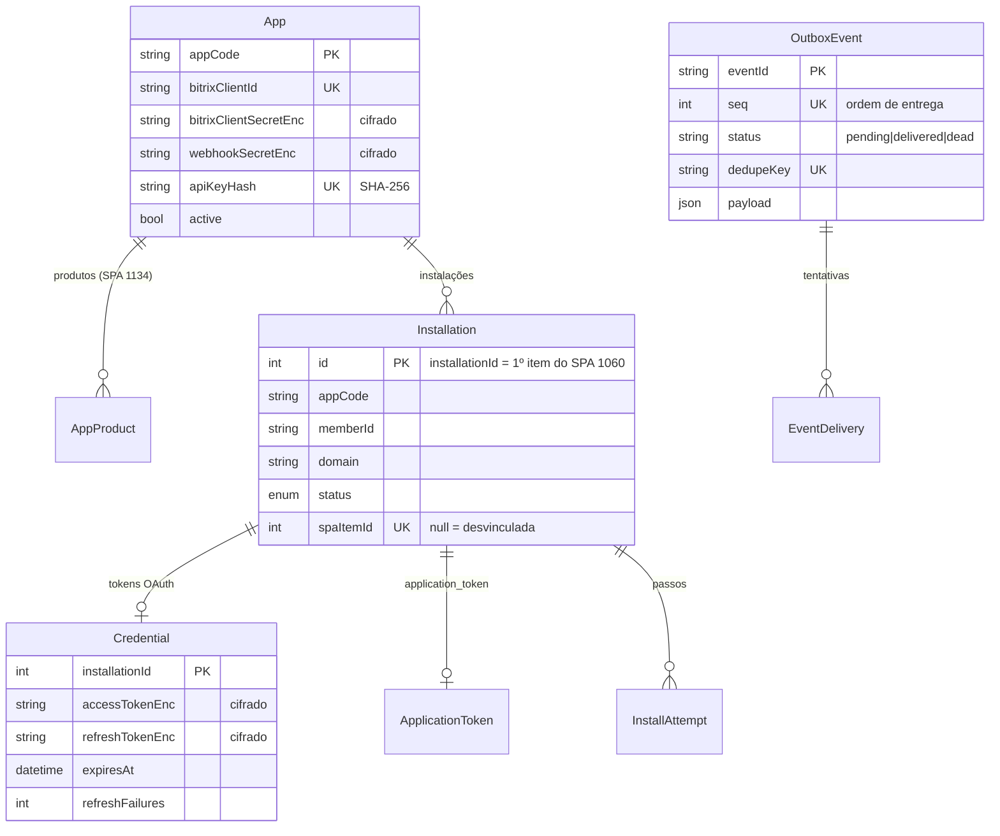

# Modelo de dados

Código: `prisma/schema.prisma` (MySQL/MariaDB via `@prisma/adapter-mariadb`),
`prisma/migrations/`, `src/config/spa-config.ts`.

A plataforma guarda em banco próprio só o **estado técnico**. O estado comercial (produtos,
planos, assinaturas, itens e o registro das instalações) mora nos SPAs do portal CRMThink, onde
o time comercial trabalha; o banco guarda versões e marcadores para sincronizar com eles.

## Diagrama

Tabelas sem relação declarada: `SigningKey`, `StripeEvent`, `SubscriptionVersion`,
`ItemVersion`, `SweepRun`, `PeriodNotice`, `Purchase`.

## Tabelas

### Aplicações

| Tabela | Propósito | Notas |
| --- | --- | --- |
| `app` | Cadastro de cada aplicação consumidora | `client_id`/`client_secret` do app Bitrix, escopos esperados, `installer_url`, `webhook_url`, tema da página de instalação, trial (`trial_days`, `trial_on_install`, `trial_plan_id`). Credencial anterior + validade durante rotação. |
| `app_product` | Produtos do SPA 1134 vinculados ao app | Um app pode ter vários (ex.: assinatura "GPTMaker" e avulso "Créditos GPTMaker"). |

### Instalações e tokens

| Tabela | Propósito | Notas |
| --- | --- | --- |
| `installation` | Um app instalado em um portal (`app_code` + `member_id` únicos) | `id` = id do primeiro item do SPA 1060 criado, estável entre reinstalações. `status`: `INSTALLING` → `ACTIVE`, ou `INSTALL_PENDING` (instalador do app falhou), `UNINSTALLED`, `AUTH_ERROR` (refresh falhou 5 vezes). `ever_activated` decide `installation.created` × `.reinstalled`. `spa_item_id = null` quando o item do SPA foi removido à mão: a instalação some para o app (404) até reinstalar. `contact` (JSON: nome, e-mail, telefone, empresa, cargo) vem da solicitação de trial pelo app (ou da importação do hub-core) e é copiado para o item do SPA 1060; o checkout usa o e-mail. |
| `credential` | Access/refresh token do Bitrix (cifrados), validade, endpoint REST | `refresh_failures` e `last_refresh_error` alimentam o `AUTH_ERROR`. |
| `application_token` | `application_token` do `ONAPPINSTALL` (cifrado) | Prova de origem do `ONAPPUNINSTALL`; entregue ao app em `GET /v1/installations/{id}`. |
| `install_attempt` | Passos da instalação (`register`, `event-bind`, `installer`) com status e erro | É como o suporte sabe onde a instalação parou (`GET /admin/installations/{id}/attempts`). |
| `signing_key` | Chaves RSA do JWT de sessão | `activated_at` (passa a assinar), `retired_at`; privada cifrada. |

### Cobrança

| Tabela | Propósito | Notas |
| --- | --- | --- |
| `stripe_event` | Todo evento Stripe recebido | Chave = id do evento (idempotência). `status`: `received` → `processed`/`ignored`, ou `failed` → `dead`. `payload` permite reprocessar do banco. |
| `subscription_version` | Versão por assinatura (SPA 1142) | `version` sobe a cada decisão e vai em `subscription.version` dos eventos. `last_written_marker` distingue escrita da plataforma de edição humana no SPA (anti-loop); `last_snapshot` é o último estado visto. |
| `item_version` | O mesmo para itens (SPA 1146) | |
| `purchase` | Compras avulsas | `pending` na criação do checkout → `paid`/`expired`/`refunded`/`partially_refunded`/`disputed`. |
| `period_notice` | Avisos de fim de período já emitidos | Chave (assinatura, fim do período, dias restantes): evita aviso duplicado. |
| `sweep_run` | Execuções das varreduras | A varredura `spa` parte do início da última execução sem erro. |

### Eventos para os apps

| Tabela | Propósito | Notas |
| --- | --- | --- |
| `outbox_event` | Evento gravado na transação da decisão | `seq` define a ordem por instalação; `dedupe_key` impede evento duplicado para a mesma decisão; `next_attempt_at`, `attempts`, `window_started_at` controlam o reenvio. |
| `event_delivery` | Cada tentativa de entrega | Status HTTP, erro, próximo horário. |

## SPAs do portal CRMThink

| SPA | Entidade | Quem escreve |
| --- | --- | --- |
| 1060 | Instalações (uma por app × portal × ambiente) | Plataforma; remoção humana desvincula |
| 1134 | Produtos | Comercial |
| 1138 | Planos (valor, intervalo, *price id* de produção e de homologação) | Comercial |
| 1142 | Assinaturas (status, modalidade `stripe`/`manual`, período, plano) | Plataforma (Stripe) e comercial (manual) |
| 1146 | Itens de assinatura | Apps via API e pessoas no SPA |

IDs de SPA, campos UF e IDs de enum são configuráveis (`SPA_CONFIG_FILE`, padrões em
`src/config/spa-config.ts`); `/health/ready` falha se o portal não tiver algum campo ou enum.

## Migrações

`prisma/migrations/` aplicadas com `yarn prisma:migrate` (`prisma migrate deploy`) no deploy.
O cliente é gerado em `prisma/generated/prisma` (`yarn prisma:generate`), importado como `@/prisma/client`.
