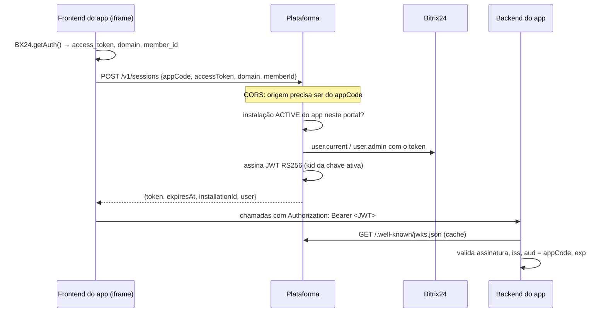

# Sessão do iframe

Código: `src/modules/installations/application/session-service.ts`,
`application/signing-keys.ts`, `application/bitrix-auth-verifier.ts` (`verifyUser`),
`http/routes.ts` (`sessionCors`), `src/cli/rotate-signing-key.ts`; SDK `sdk/typescript`
(`createSessionVerifier`).

Operações: `createSession`, `getJwks`, `rotateSigningKey`.

## Fluxo

- O corpo só fornece a pista; **identidade e admin vêm do Bitrix** com o próprio token. Campos
  extras (ex.: `isAdmin`) são descartados.
- Recusas: app inativo (403 `APP_INACTIVE`), sem instalação `ACTIVE` no portal ou domínio
  divergente (403 `INSTALLATION_NOT_ACTIVE`), token recusado (403 `BITRIX_TOKEN_REJECTED`),
  origem não autorizada (403 `ORIGIN_NOT_ALLOWED`).
- A política de acesso (quem pode o quê dentro do app) é do app; a plataforma só atesta quem é o
  usuário e se ele é admin do portal.

## JWT

| Claim | Valor |
| --- | --- |
| `iss` | `JWT_ISSUER` ou `PUBLIC_BASE_URL` |
| `aud` | `appCode` |
| `sub` | id do usuário no Bitrix |
| `installationId`, `memberId`, `domain` | instalação |
| `isAdmin`, `name`, `departmentIds` | do Bitrix |
| `exp` | agora + `JWT_TTL_SECONDS` (padrão 900) |

Header: `alg: RS256`, `kid`, `typ: JWT`.

## Chaves e rotação

`signing_key` guarda o JWK público e a chave privada cifrada. Estados:

1. **Publicada**: criada com `activated_at` no futuro — já aparece no JWKS.
2. **Ativa**: a de `activated_at` mais recente já alcançado; assina os tokens novos.
3. **Aposentada**: substituída; continua no JWKS até `ativação da sucessora + TTL do token + 5 min`,
   para os tokens já emitidos continuarem válidos.

Rotação: `POST /admin/signing-keys/rotate {leadMinutes}` (padrão 10) ou
o comando `node dist/src/cli/rotate-signing-key.js --lead=<min>` quando a API não sobe
(`docker run --rm --network crmthink --env-file <DEPLOY_DIR>/.env "$(docker inspect -f '{{.Config.Image}}' <COMPOSE_PROJECT>-api)" node dist/src/cli/rotate-signing-key.js`;
em desenvolvimento, `yarn admin:rotate-signing-key`). O `leadMinutes` dá tempo para os apps
renovarem o cache do JWKS (que a plataforma serve com `max-age=300`) antes de a chave nova
assinar. No primeiro boot sem chave no banco, `JWT_SIGNING_PRIVATE_KEY` semeia a primeira;
sem nenhuma das duas, o boot falha e `/health/ready` acusa `signingKey`.
