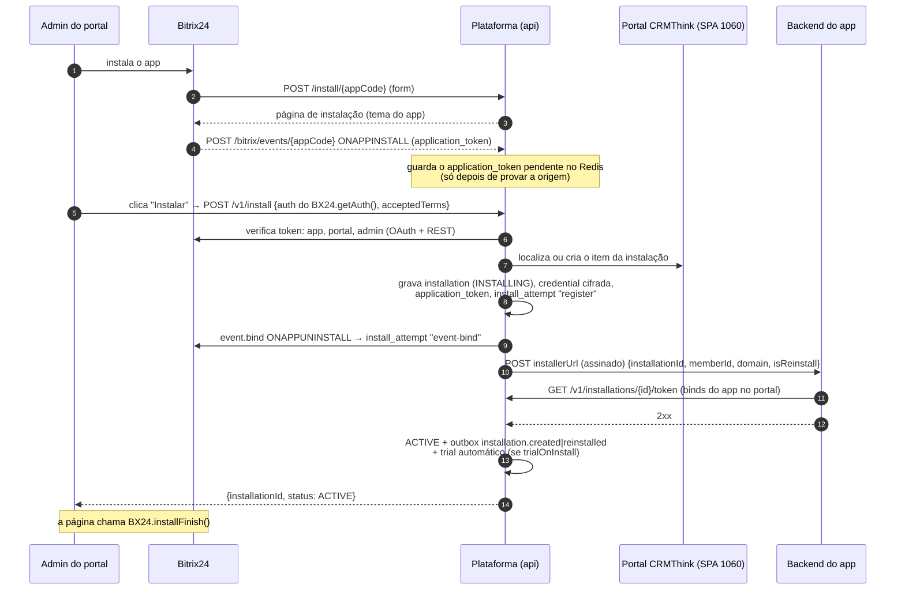
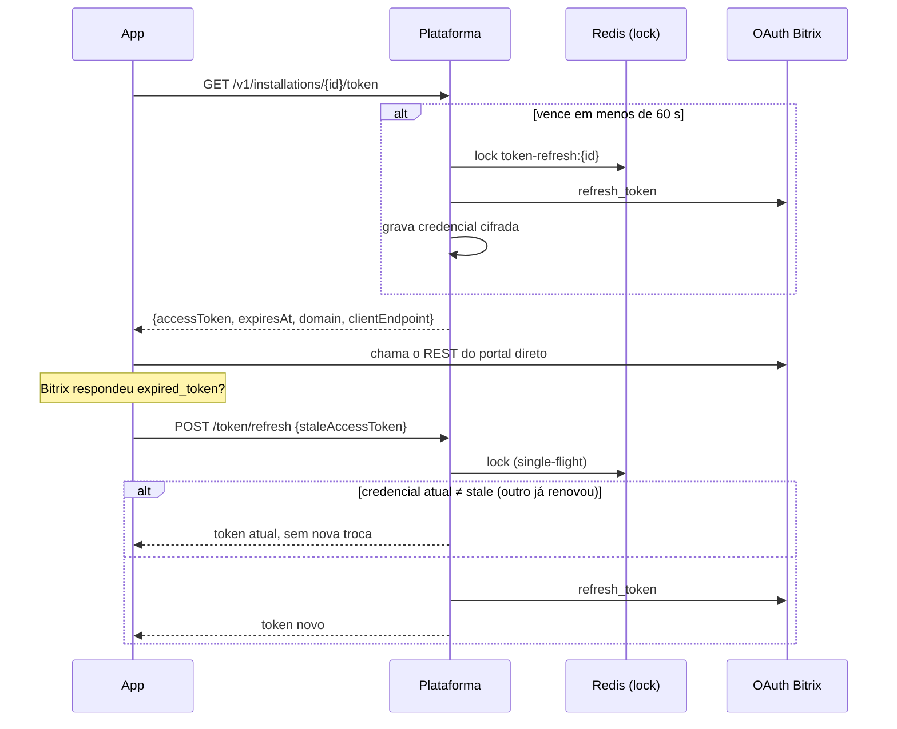

# Instalação e cofre de tokens

Código: `src/modules/installations/` — `http/routes.ts`, `http/install-page.ts`,
`application/install-service.ts`, `application/bitrix-auth-verifier.ts`,
`application/bitrix-app-events.ts`, `application/token-vault.ts`,
`infra/installer-client.ts`, `infra/installation-spa.ts`.

Operações: `getInstallPage`, `install`, `retryInstall`, `receiveBitrixAppEvent`,
`listInstallations`, `getInstallation`, `getInstallationToken`, `refreshInstallationToken`
(ver `/docs`).

## Instalação

No app Bitrix24 (um por ambiente) ficam cadastrados:

- URL de instalação: `https://<plataforma>/install/<appCode>`
- Handler de eventos: `https://<plataforma>/bitrix/events/<appCode>`

Propriedades:

- **Idempotente e sem rollback**: os passos são lineares; repetir o mesmo `POST /v1/install`
  retoma do início sem duplicar (item do SPA, credencial e evento são *upserts*; o evento de
  ativação tem `dedupeKey`).
- **`installationId` estável**: é o id do primeiro item do SPA 1060. Item removido à mão é
  recriado e revinculado na próxima instalação.
- **Instalador do app falhou** (não 2xx ou mais de `INSTALLER_TIMEOUT_MS`): a instalação fica
  `INSTALL_PENDING` e a resposta traz `error`. A página oferece "tentar novamente", que chama
  `POST /v1/install/retry` — só o instalador é refeito (exige admin do portal). O token já está
  disponível ao app em `INSTALLING`/`INSTALL_PENDING` justamente para os binds.
- **Reinstalação**: portal que já teve `ACTIVE` recebe `isReinstall: true` e o evento
  `installation.reinstalled`. Se estava em `AUTH_ERROR`, sai também `installation.auth_restored`.
- **Trial automático** falho não impede a instalação: fica no log e o operador usa
  `POST /v1/installations/{id}/trial`.
- Escopos do app Bitrix diferentes do cadastro geram alerta `install.scopes_missing`.

## Desinstalação

`ONAPPUNINSTALL` chega em `/bitrix/events/{appCode}`. O `application_token` do evento é
comparado ao guardado; bate ⇒ `UNINSTALLED`, `uninstalled_at`, evento `installation.removed`.
Diverge ⇒ 401 sem tocar na instalação. Sem token guardado (instalação importada ou
`ONAPPINSTALL` perdido), só é aceito se o Bitrix já recusa o token da instalação.

Depois de `UNINSTALLED`, `GET /token` responde 410 `INSTALLATION_UNINSTALLED`.

## Cofre de tokens

**Só a plataforma renova tokens.** O Bitrix rotaciona o refresh token a cada troca; duas
renovações concorrentes (dois apps, dois processos) derrubam a credencial.

- **Lock por instalação** (`token-refresh:{id}`, TTL 20 s, espera até 15 s) em toda renovação —
  sob demanda, na entrega e no job. Dentro do lock a credencial é relida: quem esperou recebe o
  token já renovado. No mesmo processo, `SingleFlight` junta chamadas antes do Redis.
- **Job `refresh-tokens`** (a cada 60 s): renova credenciais que vencem em menos de 10 min
  (até 200 por ciclo) de instalações `ACTIVE`/`INSTALLING`/`INSTALL_PENDING`.
- **Falhas**: só recusa do OAuth (`invalid_grant`...) conta; indisponibilidade do Bitrix não prova
  credencial inválida (503 `BITRIX_UNAVAILABLE`). Na 5ª recusa seguida a instalação vira
  `AUTH_ERROR`, sai `installation.auth_error` e o token passa a responder 409 `AUTH_ERROR` até a
  reinstalação.
- Lock ocupado além da espera: 503 `TOKEN_REFRESH_BUSY` (repetir). Falha do OAuth na renovação
  sob demanda: 502 `TOKEN_REFRESH_FAILED`.
- Métricas: `platform_token_refreshes_total`, `platform_token_refresh_failures_total`,
  `platform_token_api_duration_seconds`.

## Consultas do app

`GET /v1/installations?memberId=` e `GET /v1/installations/{id}` devolvem status e o
`application_token` (para o app validar eventos do Bitrix que receba diretamente). Instalação
de outro app ou desvinculada do SPA responde 404.
