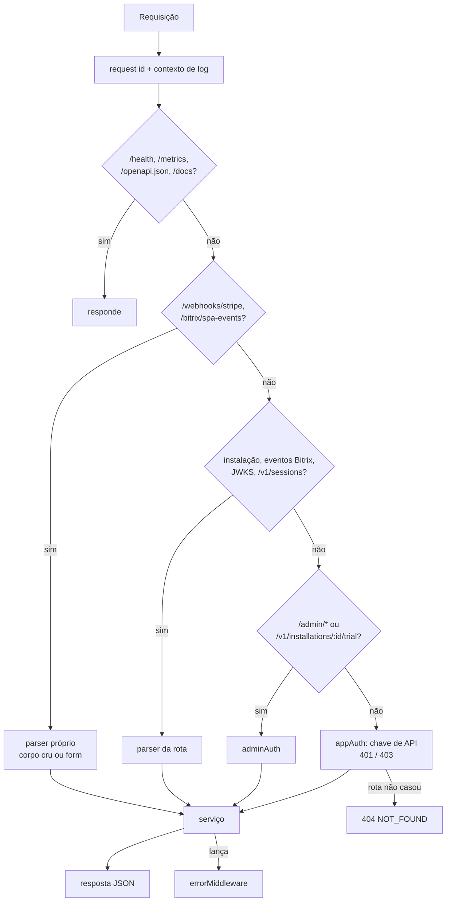

# Ciclo de uma requisição HTTP

Código: `src/app.ts`, `src/shared/http/errors.ts`, `src/modules/registry/http/auth.ts`,
`src/shared/observability/log-context.ts`.

## 1. Request id e contexto de log

O primeiro middleware usa `X-Request-Id` do cliente (ou gera um UUID), devolve-o no header de
resposta e abre um contexto `AsyncLocalStorage` (`runWithLogContext`). Todo log emitido
durante a requisição leva `requestId`; serviços acrescentam `appCode`, `installationId`,
`subscriptionId` e `eventId` com `setLogContext`/`runWithLogContext`. No `finish` sai uma
linha `request` com método, caminho, status e duração.

## 2. Ordem de montagem

A ordem em `createApp` é deliberada:

1. `/health`, `/health/ready`, `/metrics`; depois `/openapi.json` e `/docs`.
2. `billingWebhookRoutes` — `/webhooks/stripe` e `/bitrix/spa-events`.
3. `publicInstallRoutes` — página de instalação, `POST /v1/install[/retry]`, eventos do Bitrix, JWKS.
4. `sessionRoutes` — `POST /v1/sessions` com CORS próprio.
5. `adminRoutes` — `/admin/*` e `POST /v1/installations/:id/trial` com `adminAuth`.
6. Um `Router` com `appAuth` e, dentro dele, as rotas servidor-a-servidor de instalações/tokens
   e de cobrança.
7. Fallback 404 e `errorMiddleware`.

Como o `appAuth` é um middleware do router do passo 6, **qualquer caminho que não casou
antes passa por ele**: rota inexistente sem chave responde 401; com chave válida, 404.

## 3. Parsers por rota (sem `express.json()` global)

Não há parser global de propósito:

- **Stripe** assina os **bytes** do corpo; `/webhooks/stripe` usa `express.raw` (1 MB). Um
  `express.json()` global consumiria o stream e quebraria a verificação.
- **Bitrix24** envia eventos como `application/x-www-form-urlencoded` (`auth[application_token]`,
  `data[FIELDS][ID]`...); as rotas de eventos usam `express.urlencoded({ extended: true })`
  seguido de `express.json` (64 KB).
- As demais rotas declaram `express.json` com limite pequeno (4–64 KB) no próprio router.

## 4. Autenticação

| Superfície | Mecanismo | Falha |
| --- | --- | --- |
| Rotas servidor-a-servidor (`/v1/installations*`, `/v1/plans`, `/v1/subscriptions*`, checkout, portal) | `appAuth`: `Authorization: Bearer <apiKey>` → hash SHA-256 → app em `res.locals.app` | 401 `UNAUTHORIZED`; app inativo 403 `APP_INACTIVE` |
| `/admin/*`, trial manual | `adminAuth`: Bearer comparado em tempo constante com `ADMIN_API_TOKENS` | 401 `UNAUTHORIZED` |
| `POST /v1/install`, retry, `POST /v1/sessions` | Token do Bitrix do corpo, verificado **no Bitrix** (ver [installation-and-tokens.md](installation-and-tokens.md)) | 403 com o código da verificação |
| `/bitrix/events/:appCode` | `access_token`/`application_token` do evento | 401 |
| `/bitrix/spa-events` | `auth[application_token]` = `CRMTHINK_APPLICATION_TOKEN` | 401 |
| `/webhooks/stripe` | `Stripe-Signature` | 400 `INVALID_SIGNATURE` |

Toda consulta de app é filtrada pelo `appCode` da chave: instalação ou assinatura de outro app
responde 404, a mesma resposta de "não existe".

## 5. Validação, handlers e erros

- Corpos são validados com os schemas zod exportados pelos serviços
  (`installRequestSchema.parse(req.body)` na rota). `ZodError` vira 400 `VALIDATION_ERROR` com
  `details: [{ path, message }]`.
- `:id` numérico passa por `intParam`: id inválido é 404 com o código do recurso.
- Handlers assíncronos são embrulhados em `asyncHandler`, que encaminha rejeições ao
  `errorMiddleware`.
- Serviços lançam `HttpError(status, code, message)` pelos atalhos `badRequest`, `forbidden`,
  `notFound`, `conflict`, `gone`, `unprocessable`, `upstream`.
- `errorMiddleware` serializa `{ error: { code, message, details } }`. Status ≥ 500 e erros não
  tratados vão para o log; não tratados viram 500 `INTERNAL_ERROR` sem detalhes.

Os códigos estáveis estão em [error-codes.md](error-codes.md).

## 6. Conferência com o contrato nos testes

`http(h)` (`src/test/app.ts`) envolve o app e confere cada `res.json` com o schema do OpenAPI
para aquele método, rota e status — inclusive se o código de erro está declarado na operação.
Divergências falham o teste no `afterEach` (`src/test/setup-env.ts`).
